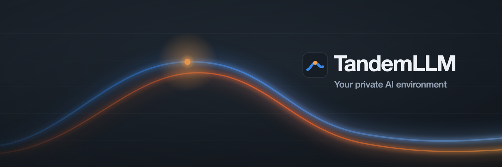
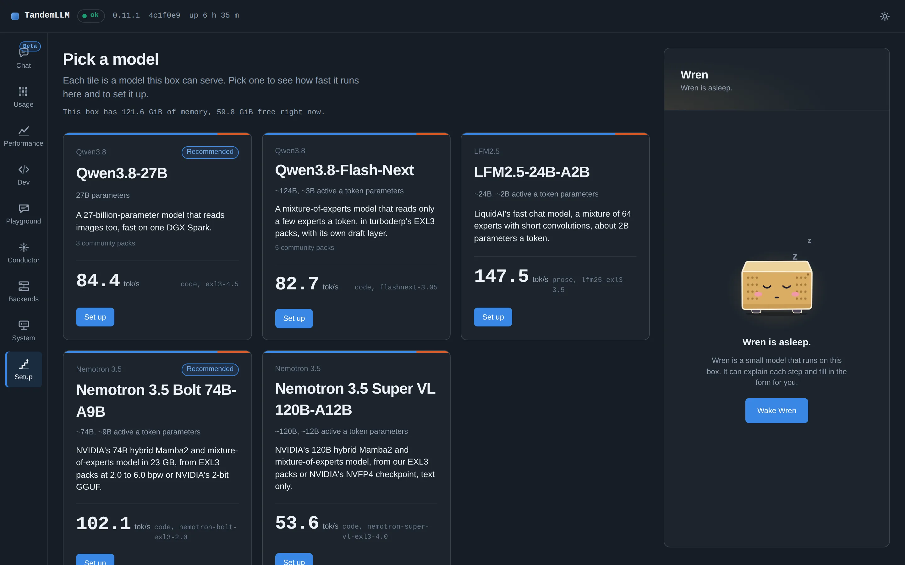
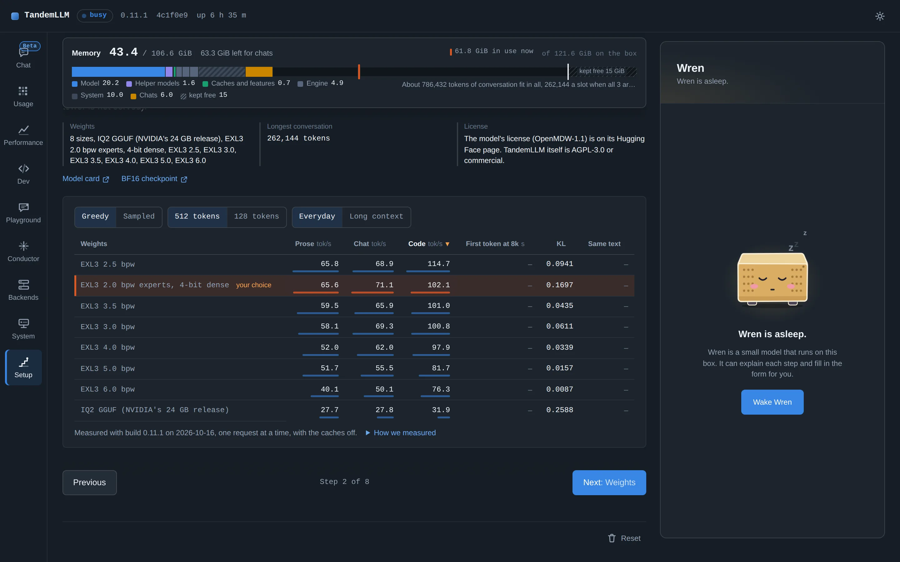
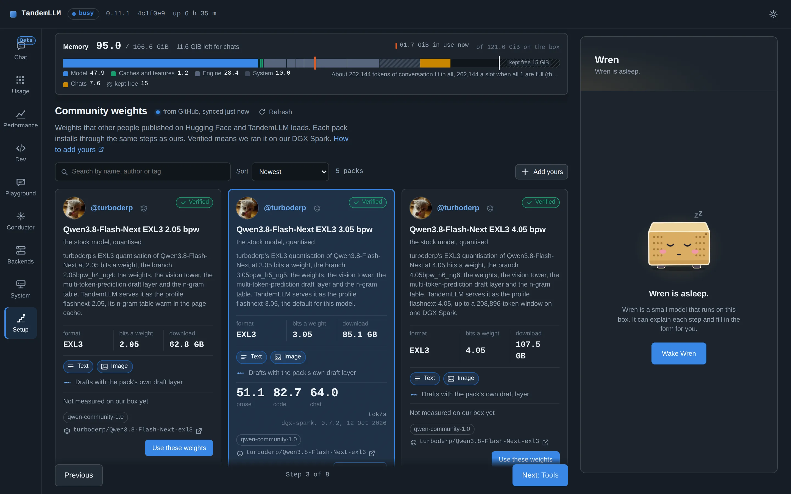
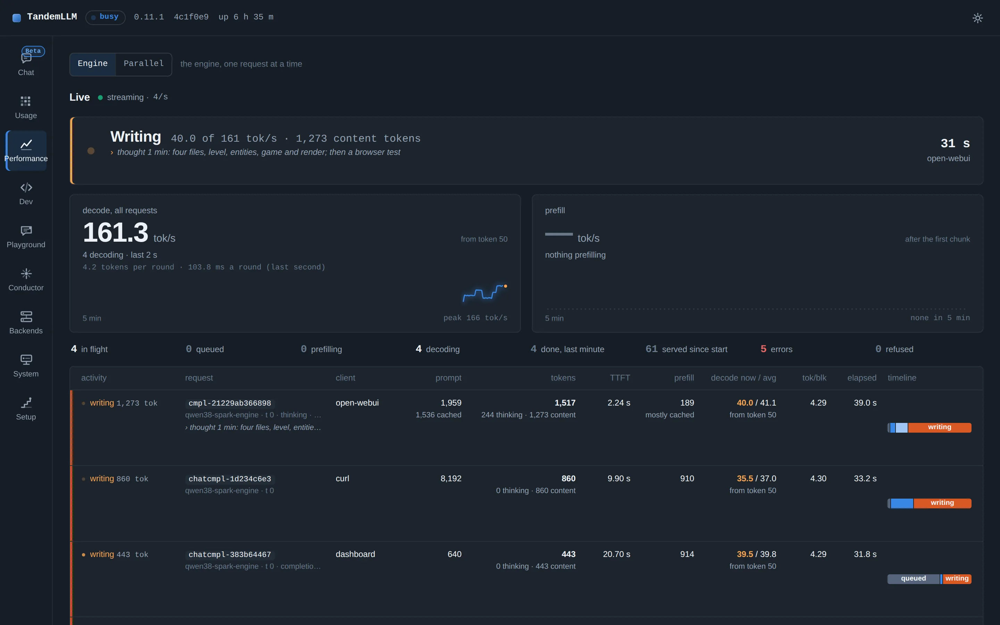
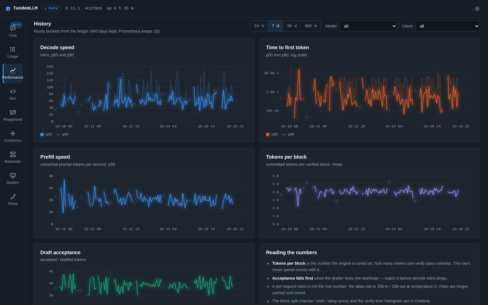
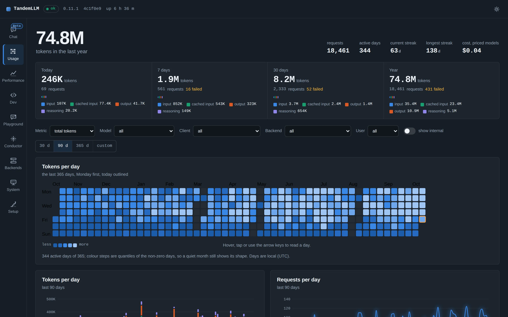

  

<h1 align="center">TandemApp</h1>

  
  
  
  
  
  

  
  
  
  

<table>
  <tr>
    <td width="33%" valign="top"> Setup Guide: one tile per model, each with its measured speed.</td>
    <td width="33%" valign="top"> Each size's tok/s and KL, here Nemotron 3.5 Bolt.</td>
    <td width="33%" valign="top"> Community weights with their maker: turboderp's Flash-Next packs.</td>
  </tr>
  <tr>
    <td width="33%" valign="top"> Performance: live decode speed and every running request.</td>
    <td width="33%" valign="top"> History: decode speed, first-token time, tokens per block, draft acceptance.</td>
    <td width="33%" valign="top"> Usage: tokens per day for a year.</td>
  </tr>
</table>

  More pictures, the Chat tab (beta) among them: <a href="docs/gallery/README.md">docs/gallery</a>

TandemApp is a dashboard, gateway and usage ledger in front of OpenAI-compatible servers and
cloud APIs. Clients send their requests to one address; TandemApp routes each one by its model id
to the backend that serves it and records tokens, timings and cost. It also manages a fleet of
machines through TandemNode, its agent on each machine, and carries Chat (chatd) and the
conductor.

TandemApp runs no model itself. The engine is a separate project,
[TandemEngine](https://github.com/TandemLLM/TandemEngine); TandemApp talks to it, and to any other
OpenAI-compatible server, over HTTP. The engine API it expects is
[contracts/engine-api-v1](contracts/engine-api-v1/README.md).

## Install

From a release: the archive carries the built page, so the host needs Python alone.

    curl -fsSLO https://github.com/TandemLLM/TandemApp/releases/download/v0.16.0/tandemapp-0.16.0.tar.gz
    tar -xzf tandemapp-0.16.0.tar.gz && bash tandemapp-0.16.0/packaging/install.sh

A release also has the wheel the engine loads as its extension for the chat mode
(`tandemapp-0.16.0-py3-none-any.whl`, for the engine's `install.sh --with-chat --app-wheel FILE`), the
page alone (`tandemapp-dashboard-0.16.0.tar.gz`) and the Helm chart (`tandemapp-0.16.0.tgz`).

From a checkout:

Python 3.11 or newer. The web page is a build output and not in git: build it with Node 20.19 or
newer, or fetch a released bundle (`tools/dashboard_bundle.py fetch`).

    python3 tools/dashboard_bundle.py build
    python3 -m pip install '.[app]'       # '.[host]' adds NVML for GPU hosts

Other ways: `brew install ./packaging/homebrew/tandemapp.rb`, or the image
`docker build -f packaging/Dockerfile.app -t tandemllm-app .`

## Run

    tandem-app                            # 127.0.0.1:8080, state in ~/.tandemllm
    open http://127.0.0.1:8080/dashboard/

`tandem-app service install --open` runs it in the background (launchd on macOS, a systemd user
unit on Linux). `tandem-app check` prints what would run without starting anything.

## Layout

| path | what it is |
|-|-|
| `proxy/` | the controller: gateway, ledger, fleet, `tandem-app` and `tandem-node` |
| `tandemapp/` | the conductor and the dashboard API |
| `chatd/` | Chat's service |
| `dashboard/` | the web page (TypeScript, Vite) |
| `contracts/` | the API contracts with the engine and between the parts |
| `packages/` | the texts the conductor ships with |
| `packaging/` | the build backend, Dockerfile and Homebrew formula |
| `tests/`, `tools/` | the test suite and the tools |
| `docs/` | the documentation (`docs/README.md`); `docs/reference/` is generated from the code by `tools/gen_reference.py` |

## Tests

    python3 tests/script_suite.py --all
    (cd dashboard && npm ci && npx vitest run)

## Documentation

[docs/README.md](docs/README.md) lists the pages: [docs/proxy.md](docs/proxy.md) covers configuration, the fleet, TandemNode and the data plane, and the others the dashboard, the Chat tab, the conductor and its chat mode inside the engine. [CHANGELOG.md](CHANGELOG.md) lists the changes.

## Support

TandemLLM is free and open source. If it saves you time or money, you can help keep it going:

- [Buy me a coffee on Ko-fi](https://ko-fi.com/0xbakeer)
- [Sponsor on GitHub](https://github.com/sponsors/0xBakeer)
- Follow [@TandemLLM](https://x.com/TandemLLM) for releases and [@0xBakeer](https://x.com/0xBakeer) for the work behind them
- Enterprise solutions and the commercial license: [mail@0xbakeer.com](mailto:mail@0xbakeer.com)

## License

AGPL-3.0-only ([LICENSE](LICENSE)), or a commercial license
([COMMERCIAL-LICENSE.md](COMMERCIAL-LICENSE.md)). Third-party notices: [NOTICE](NOTICE). The
documentation in `docs/` is CC BY 4.0 ([docs/LICENSE](docs/LICENSE)).
