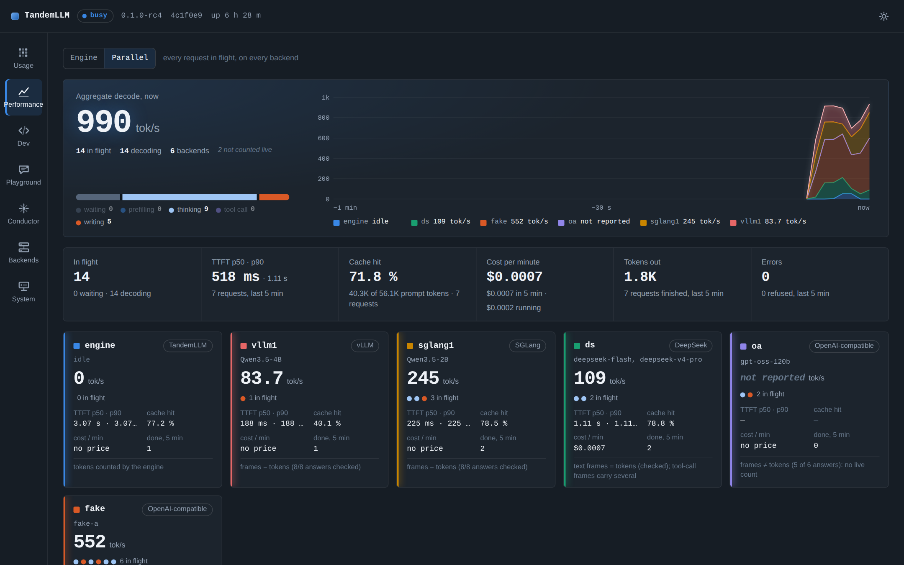

# Monitoring: several engines and the machines behind them

With more than one backend, the dashboard answers three questions for all of them at once: what each request is doing right now, how each engine is doing inside, and how the machine behind it is doing. Each answer has its own source, and each source is optional. All of it is measured or null, never estimated: a figure a backend does not report reads “not reported by this backend”.

| layer | where it reads | what it gives | needs |
|-|-|-|-|
| the relay | every answer the proxy relays | per request: tokens from `usage`, cached and reasoning tokens where reported, TTFT and decode rate at the proxy, cost | nothing |
| L1: the engine's page | vLLM's and SGLang's `/metrics`, every 15 s | per engine: requests running and waiting, KV use, decode rate, prefix-cache hits, TTFT, queue and prefill percentiles, preemptions, speculation | kind `vllm` or `sglang`; SGLang `--enable-metrics` |
| L2: the plugin | a plugin inside vLLM or SGLang, posting once a second | per request: the engine's own queue, prefill and decode time, cached tokens, preemptions, finish reason | the plugin and two variables |
| the host collector | the machine behind each backend | memory, CPU, GPUs, disks, network, the process behind each backend's port | nothing here; a collector or exporters on a remote machine |

*The four layers TandemApp reads.*

## Every request at once

Performance, Parallel (`#/performance?tab=parallel`) shows every request in flight on every backend, the engine included. It reads `GET /v1/dashboard/parallel` once a second; the server builds the document at most every 0.4 s for all viewers, and a poll with `since` carries only the new samples.



*The Performance view, Parallel page: every request in flight on six backends, the aggregate decode rate, and one card per backend. Demo data from the dashboard's mock server (`npm run preview:mock`), not a measurement.*

- The aggregate decode rate now, and its last five minutes stacked by backend.
- The requests by state: waiting, prefilling, thinking, tool call, writing.
- The time to first token at p50 and p90, the cache hit and the cost per minute, over the requests finished in the last five minutes.
- One card per backend.
- One lane per request: backend and model, client, session, state, tokens with thinking apart, decode tok/s now and on average, TTFT, prefill rate, cache, cost so far, elapsed. A lane keeps its row until a few seconds after it ends.

A lane's live token count comes from the best source the backend allows. The engine's own requests use the engine's count. A TandemLLM backend behind a proxy is read from that engine's own board once a second, because the relay tags each request with `X-Tandem-Relay-Id`; the engine streams blocks of several tokens, so its frames are not a count. Any other backend's stream frames count only after they were checked: each finished streamed answer's frames are compared with its `usage.completion_tokens` (within 2 tokens and 1 %), answers with and without tool calls apart, and two passing answers of a kind with no failure among the last 8 make the frames a count. DeepSeek's reasoning and content frames are one token each; its tool-call arguments arrive several tokens a frame, so a DeepSeek lane has no live count while it writes a call. Without a count a lane shows its frames and “not reported”, and its tokens arrive with the usage at the end.

| agent-like sessions at once | 8 | 16 | 32 |
|-|-|-|-|
| aggregate tok/s, all lanes | 526 | 896 | 1,495 |

*A load test of the Parallel view, not an engine benchmark: N agent-like sessions (a system prompt, two tools, up to three streamed turns) through a test proxy in front of a cloud API, the engine and two fake backends, 0 errors in each run. The aggregate is the sum over every backend. Measured: `tools/parallel_load.py`, the 0.4.0 series. With 32 streams the page's document took about 1 ms to build and a poll was at most 55 KB.*

`tools/parallel_load.py` drives the page on your own backends, for example `--mix deepseek-flash=10,TandemLLM=2 --duration 90 --budget-usd 0.5 --board`. It reports TTFT, decode rate, cache hit, throughput and cost per model, stops starting turns at the budget, and with `--board` puts the page's per-second series beside the frames its own clients received.

## Inside vLLM and SGLang: the engine's page (L1)

For a backend of kind `vllm` or `sglang` the proxy reads the engine's `/metrics` every 15 s through a name table checked against vLLM v0.30.0 and SGLang v0.5.21 (`proxy/engines.py`). Window figures come from the first and the newest reading of the last 5 minutes; with one reading, or no traffic in the window, they are null. A family a release renamed maps to nothing and its tile says “not reported by this backend”: a new release can cost a tile, never a failed read. After a failed read the proxy waits 30 s, then 60, then 120 s.

| figure | vLLM | SGLang |
|-|-|-|
| running, waiting | `vllm:num_requests_running`, `_waiting` | `sglang:num_running_reqs`, `num_queue_reqs` |
| KV in use | `vllm:kv_cache_usage_perc` | `sglang:token_usage` |
| decode rate | `vllm:generation_tokens_total` over the window | `sglang:generation_tokens_total`, `gen_throughput` |
| prefix-cache hits | `vllm:prefix_cache_hits_total` over `queries_total` | `sglang:cached_tokens_total` over `prompt_tokens_total` |
| queue, prefill, decode | `vllm:request_queue_time_seconds` and siblings | `sglang:queue_time_seconds` only |
| preemptions | `vllm:num_preemptions_total` | `sglang:num_retracted_requests_total` |
| speculation | drafts, draft tokens, accepted tokens, and acceptance per draft position | `sglang:spec_accept_rate`, `spec_accept_length` |

*The engine figures and the families they come from.*

The proxy's own `/metrics` carries the mapped families as `qse_backend_*` with a `backend` label, for a Prometheus of your own; they never enter the engine's own families. Mapping one page of about 500 lines takes about 2 ms on the poller's own thread, and a relay thread never waits for it.

## Inside vLLM and SGLang: the plugins (L2)

The page gives totals. A single request's queue time, its prefill time and whether the scheduler preempted it are not on it. Two small packages in `plugins/` run inside the engine and send those numbers per request:

```sh
pip install plugins/vllm    # tandemllm-vllm-plugin, into vLLM's own Python
pip install plugins/sglang  # tandemllm-sglang-plugin, into SGLang's own Python
TANDEM_COLLECT_URL=http://proxy-host:8080/v1/collect/<backend id>
TANDEM_COLLECT_TOKEN=<the proxy's collect token>
```

vLLM loads its plugin from the `vllm.stat_logger_plugins` entry point, once per data-parallel engine in its API server process; SGLang loads its plugin from `sglang.srt.plugins` in every process it starts, with two hooks on its tokenizer manager and its scheduler's metrics collector. Neither package has a dependency, and neither reads a prompt, an answer or a token id: each item is counts and times. A plugin keeps the last 10,000 finished requests and 300 one-second scheduler samples in memory and posts what is new once a second, or an empty batch every 10 s when the engine is idle. The collect token is `TANDEM_COLLECT_TOKEN` in the proxy's environment, or one the proxy makes and stores in its config database at the first need; it lets its holder post numbers for a backend that exists, nothing else.

The proxy joins each item to the request's ledger row by an id it sends upstream: vLLM gets `X-Request-Id: px-<hex>` and reports `chatcmpl-px-<hex>`; SGLang gets `rid` in the body. A client that sets its own id keeps it, and the join uses it. The row then gets the engine's own `queue_ms`, `prompt_ms`, `decode_ms`, `decode_tps`, `prefill_tps`, `cached_tokens`, `preemptions` and `engine_finish`, and `l2_join` says `exact`. A request the proxy cannot tag (the Responses API, SGLang with `n` above 1) is matched by time and token counts when exactly one row fits, and says `approximate`. An item waits up to 10 minutes for its row, and a row for its item.

The engine always starts. If the plugin does not fit a release, vLLM's loader logs the import error and starts without it, SGLang skips a renamed hook target, and a failing hook is logged at most once a minute and switches itself off after 100 failures in a row. The backend's card says “L2 plugin” while batches arrive and “L1 only” after 60 s without one.

## The machine behind each backend

The System view lists the machines: this one first, with the server's own process, then the machine behind each backend, down to the process behind the backend's port. For a vLLM on the same machine that is its API server and its engine core, with their RSS, CPU, threads, uptime and GPU memory. A backend's host setting says where to read it:

| setting | reads | per process |
|-|-|-|
| `auto` | this machine when the backend's URL is loopback or one of its addresses; nothing for a cloud API | yes |
| `same` | this machine, whatever the URL says | yes |
| `collector` | `tandem-app hostcollect` on the backend's machine | yes |
| `exporter` | a node_exporter page and a DCGM exporter page | no |
| `off` | nothing |  |

*A backend's host setting.*

On a remote machine, run the collector next to the backend and give both sides the same token:

```sh
# on the backend's machine
TANDEM_COLLECTOR_TOKEN=$(openssl rand -hex 24) tandem-app hostcollect --host 0.0.0.0 --port 9108
# on the proxy's machine
TANDEM_COLLECTOR_TOKEN=<the same token>
TANDEM_BACKEND_VLLM1_HOST=collector
TANDEM_BACKEND_VLLM1_HOST_URL=http://gpu-host:9108
```

The collector answers `GET /host` as JSON and `GET /metrics` as Prometheus text (`tandem_host_*`), both behind the bearer token. It refuses to bind beyond loopback without one, because its answer names processes and their command lines. Command lines show the home as `~`, and the value after any flag whose name holds `key`, `token`, `secret`, `passw` or `auth` is masked. A remote read runs on its own thread, so a slow or dead host never holds the page.

On a GB10 the CPU and the GPU share one memory pool. The driver reports no memory for the GPU itself, so the view shows “unified” there and `MemAvailable` is the figure to watch. Nothing is sampled while nobody looks: when the System view asks, the collector reads at most every 5 s and scans the processes at most every 15 s. Measured on a DGX Spark against the running engine: one sample with a process scan cost 7.46 ms of CPU, 0.050 % of a core at that cadence; the memory figures equalled `/proc/meminfo` to the byte, and the engine's GPU memory equalled `nvidia-smi`'s within 49,152 bytes of 81.7 GB (measured, the 0.4.0 series).

## Your own Prometheus

The controller's `/metrics` (the `metrics:read` permission: a viewer's session or an API token with that scope, docs/auth.md) carries its own families (`qse_proxy_requests_total`, `qse_proxy_tokens_total`, `qse_proxy_cost_micros_total`, `qse_proxy_ttft_seconds`, `qse_backend_up`, `qse_backend_inflight` and more), the mapped engine families as `qse_backend_*`, and the plugin's age and joins. The collector's `/metrics` carries `tandem_host_*`. [reference/metrics.md](reference/metrics.md) lists every family registered in the code.

