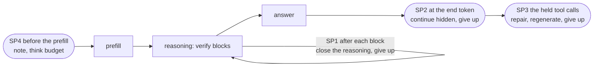

# The session monitor

The session monitor is the conductor's second half. The router plans a turn before it runs; the monitor watches the turn while it runs and acts when the model goes wrong in a way it can recognise without guessing: a reasoning block that goes in circles, an answer that ends empty, a tool call that does not parse, the same call a third time, a claim of done without the evidence. This page lists where it may act, what it may do, and each task.

## Modes and policy

`--conductor raw|shadow|on` switches it. `raw`, the code default, runs none of it, and nothing closes a reasoning block but a budget. `shadow` runs every rule and journals what it would do, and executes nothing. `on`, the shipped profile's value, executes each task in the mode its policy gives it. A request's `X-Tandem` header can lower the mode, never raise it, and a request with `n` above 1 never acts.

The policy is a file, `ops/supervisor.yaml`, validated at start against `ops/supervisor.schema.json`. It holds every task's mode (`off`, `shadow`, `act`), every threshold and every text the monitor may write. The conductor keeps it as its `monitor` document, versioned and edited like the others, and a profile's `tasks` section overrides a task's mode per profile.

## Safe points and actions

The monitor acts only at four safe points, from a fixed set of actions.

*The session monitor's four safe points on one request: before the prefill, after each committed block, at the end token before it reaches the client, and when the answer's held tool calls are complete.*

| point | when | actions |
|-|-|-|
| SP4 | the prompt is rendered, before the prefill | `PROMPT_TAIL_NOTE`, `SET_THINK_BUDGET` |
| SP1 | a verify block is committed | `CLOSE_REASONING`, `GIVE_UP` |
| SP2 | the model wrote its end token, before the client sees it | `CONTINUE_HIDDEN`, `GIVE_UP` |
| SP3 | the answer ended and its tool calls are held | `REPAIR_CALL`, `REGENERATE_CALL`, `GIVE_UP` |

*Safe points and the actions each allows.*

What the client sees is little. A hidden close forwards the policy's phrase through the engine and streams only from the closer on (`</think>` in the `tags` format). A hidden continue drops the end token and forwards a nudge, and the answer follows in the same response. `GIVE_UP` is one visible sentence with finish `stop`. Hidden tokens are never in `usage`, never in the suffix store, and a response the monitor acted on is not stored in the response cache. The KV holds them, and the end anchor puts them back into the next prompt where the rows hold them ([TandemEngine's caches](https://github.com/TandemLLM/TandemEngine/blob/main/docs/caches.md#after-a-long-generation)).

Caps hold the monitor back: at most 2 acts a request and 6 a session hour in the shipped policy, and never the same hidden action twice in a row on one turn. Beyond a cap a decision is journaled and not executed.

## The tasks

| task | rule | what it catches, and what it does | mode |
|-|-|-|-|
| D1 | `reasoning_loop` | a reasoning block that goes in circles (below); closes it, hidden | act |
| D2 | `reasoning_backstop` | reasoning that reaches 32,768 tokens, or the output limit less 2,048; closes it | act |
| E1 | `empty_turn` | an end token inside the reasoning, or an empty answer to a request that offered tools; tool calls the model wrote inside its reasoning go out as its answer when they parse and name an offered tool, else continues hidden, then gives up after two tries | act |
| E2 | `claim_check` | a coding turn that ends claiming the work is done without the tool evidence (below); acts in the `coding`, `hermes` and `chat-app` profiles, shadow in `overnight` | act |
| C4 | `malformed_call` | a tool-call block that does not parse; repairs it when the fix is not a guess, else has the model write it again | act |
| C3 | `repeated_call` | the same call a third time after identical results; asks for something different | act |
| C5 | `sequential_mutations` | an answer with two or more calls that change something outside the conversation (send, schedule, create, write, delete, read off each tool's declaration); has the model write them again one at a time, each after the last one's result | shadow; act in `tools` |
| C1 | `risk_floor` | `rm -rf` outside the project root, `git push`, a write outside the root, a download piped into a shell | shadow |
| C2 | `project_rules` | what text alone can decide of the project's `AGENTS.md`: a numbered copy of a file, a path under `/tmp/`, a written file over 400 lines | shadow |
| S1 | `gate_stagnation` | a checker gate that failed 3 times in a row without getting closer; one hidden note | act |
| S2 | `context_health` | after a compaction, two tool steps that read none of the state files; one hidden note | act |
| S4 | `stall_watchdog` | no file changed, nothing committed and no checker number better for 20 minutes; one hidden note, and a push when the client has gone | act |
| S5 | `turn_budget` | on every client: the same problem stated three times; a build turn three minutes and five tool steps in with nothing written; an Open WebUI turn past 12 minutes without a new product file, or 18 in any case; one hidden note | act |

*The session monitor's tasks, with their shipped modes.*

Each profile sets its tasks' modes on top of the policy. S5 runs under every profile that runs the monitor and needs no state file. The session tasks S1, S2 and S4 act only in the `overnight` profile, and only in a project whose system prompt names a `PROGRESS.yaml`; the tool checks run where the profile holds calls (the coding and overnight profiles).

## Reasoning loops

D1 watches the reasoning with three arms: a pattern of 1 to 16 tokens repeated at least 4 times over 128 tokens or more; the share of the last 256 tokens' 16-grams already seen earlier in the block, checked every 64 tokens once the block has 2,048; and novelty collapse, the share of new 8-grams in the last 128 tokens falling under 0.1. When an arm fires in act mode, the monitor closes the block with a hidden phrase and the model answers from what it has. D2 is the backstop: no reasoning block runs past 32,768 tokens, or past the output limit less 2,048, so an answer always has room. With the conductor raw, nothing closes a block but a budget.

## Tool-call checks

With a tool-call task able to act, every call of an answer is held until the answer ends; a block that does not parse is held too, not let out as content. At the end token every call is checked by every SP3 task before any is released. If all pass, the calls go out whole, each in one delta with an id made at release. If any act fails, none goes out: the end token is dropped, a hidden turn shaped as the calls' tool result carries the reminders, and the model writes the set again in the same response. An answer that ended without its end token (the token limit) cannot be written again, so there a failure gives up. A block the client's own stop string cut is let out as the text it was.

C4's repairs are deterministic: JSON with trailing commas or Python literals, an unquoted name, a closing tag that never came. It checks arguments against the tool's JSON schema (required keys, types) in shadow. The tool-argument loop guard ([TandemEngine's server](https://github.com/TandemLLM/TandemEngine/blob/main/docs/server.md#the-tool-argument-loop-guard-0326-test)) runs beside these checks and also stops a call that streams live.

## The claim check: E2

A model can end a coding turn with “done, verified in the browser” after a test that set a key's state in code instead of pressing it, or that read a lost game as a working one. E2 checks such a claim before the end token reaches the client. The trigger is structural: the turn's class is one of the building classes, the request offered tools, and the model wrote its end token after a non-empty answer with no tool call. Then Qwen itself answers, thinking off, one letter a question: does the message tell the user the work is done; and if so, what the tool evidence since the last write says (supported, no run after the last write, errors in the evidence, an unexplained surprise, a faked test). The questions are asked in place, inside the conversation the engine holds, because a request to the server's own port would wait for the lock the turn holds. In act mode an unsupported claim gets a hidden note with the turn's evidence digest, and the model continues.

## Turn snapshots and outcomes

A profile's `outcomes` section drives a structural reading of each tool-result turn, every switch off when absent.

- The snapshot: from the request body alone, what the session did since the last one: the calls, the files written, each screenshot's hash and size, a console's level counts and error lines, checker lines, exit codes, a test runner's counts, a state dump's diff. It is stored beside the transcript block, at most 32 KB, and takes about 0.023 ms a request (measured).
- The outcome: the first label whose facts matched, in order: no visible change (the same screenshot after a write), regression, error, low quality, surprise, stuck, tool misuse, a faked test (a script that assigns to a member of an object it did not declare), an environment error, lost context; else progress or none. Every fact is structural; no word decides what anybody meant.
- In act mode an outcome raises the turn's effort (no visible change and regression to xhigh, error to high) for two tool turns or until progress, and the acting outcomes add their note once per signature.
- Retrieval: a low-quality or stuck outcome asks the package question over the test skills, and the package that fits becomes the note.

## Session tasks

Three tasks look across turns. They read what a request carries about the turns before it, each call taken once per session by its id, so a retried request counts nothing twice. Each acts with one hidden note at the end of the prompt, and a request carries at most one of their notes. S1 watches a checker gate (a line such as `RESULT: FAIL <- ...` from a project's checker) that fails three times in a row without getting closer to its limit. S2 watches the first two tool steps after a compaction for a read of the state files. S4 watches for 20 minutes without a change, a commit or a better number. When no request comes for S4's minutes after a turn ended, the client has gone, and with the policy's `notify` on the watch sends a push to `TANDEM_NOTIFY_URL`; the URL is empty in the shipped policy.

S5, the turn budget, watches the turn: the requests that carry the same last user message. Its first arm reads the model's own visible text between its tool calls: when the first sentence states the same problem three times among the last eight problem sentences (shared word triples, a number in common), the note tells it to stop tuning, deliver what works and say what is untested. An Open WebUI agent chat had a working game after 25 minutes and then wrote “The bot is stuck at x=436” seven times while it tuned its own playtest bot; it never answered. The second arm watches a build turn: three minutes and five tool steps in, with nothing the user asked for written (a write outside the scratch directory, `/tmp`, logs and pid files), the note says to write the deliverable first. The third is a wall clock for a chat client someone waits in front of (Open WebUI): after 12 minutes of tool calls with no product file in the last 4, or after 18 in any case, the note says to finish and answer, and every 4 minutes after it a shorter one. Replayed on that chat, the notes come at 3.1, 18.0 and 36.0 minutes; on four clean opencode runs it adds none (measured). The fourth arm, `verify`, watches what follows the deliverable: when the steps since the last product write wrote only scratch files, two of them test tools (scripts or pages, not logs or data), and 90 s have passed since that write, the note says to stop building test tools, check once with a tool that works here and answer. An opencode page run wrote its page at 176 s, its last product edit at 257 s, then spent the run's remaining five minutes on a browser driver of its own; replayed, the note comes at 347 s, and four clean opencode runs get none (measured). Time alone is not a reason: opencode has no clock, and a chat client has the wall clock's quiet rule. A box whose policy is a stored document gets S5, or the keys its stored S5 lacks, with `tools/monitor_migrate.py`.

## Observability

Every decision, passes included, is one journal row and one `[conductor]` log line with the task, the decision, the reason and counts, never a text. The ledger's `requests` row gets `conductor_acts`, `conductor_hidden_tokens` and `conductor_acted`, and the dashboard's speed figures leave out the requests the conductor acted in. Prometheus counts every decision and action (`qse_conductor_*`). `GET /v1/conductor/events` lists the decisions, and `GET /v1/conductor/watch` what the session tasks hold per session.

## Extending it

The interface the policy engine builds on is kept stable. A rule is `tier0.register(name, safe_point, params, required, doc)` on a function from an event to an action; `params` is the JSON Schema of the task's parameters, which the policy schema picks up. The events are `RequestEvent`, `BlockEvent`, `FinishEvent` and `ToolCallEvent`. An action is one of the fixed set. `python tools/conductor_policy.py --schema` writes the schema from the rule registry, and `python tools/conductor_policy.py <file>` checks a policy file.

